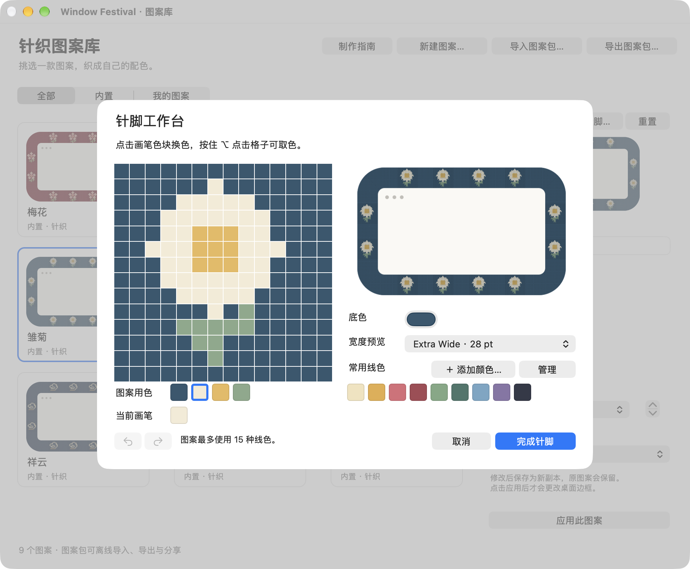

# Window Festival

Window Festival 给 macOS 窗口加上可自制的针织边框。它基于 saragordic 的 [Window Sweaters](https://github.com/saragordic/window-sweaters)，沿用原项目的毛线渲染、按应用配色和窗口跟踪，在此基础上增加了图案库和针脚编辑器。



- 内置九款图案，包括梅花、灯笼、春字、雏菊、竹叶、郁金香、祥云、菱花和柿子。
- 从空白网格或现有图案开始制作，实时预览针脚、线色、底色和边框宽度。可点击「图案用色」复用已画的颜色，也可用常用色板或系统颜色面板选色。
- 在图案库调整间距和宽度，保存副本后应用。自制图案可移到废纸篓。
- 导入、导出 `.knit.json` 图案包，离线分享自制图案。

## 从源码运行

需要 macOS 13 或更高版本，以及 Xcode Command Line Tools。构建包含 Apple Silicon 和 Intel 两个架构。本项目在 Apple Silicon 上验证，Intel 和其他 macOS 版本仍待实机测试。

在源码目录执行：

```sh
./scripts/build-app.sh
open "outputs/Window Festival.app"
```

应用运行后，点击 macOS 菜单栏里的毛线图标，选择 **Pattern Library · 图案库…**。可用[晨雾雏菊示例包](examples/mist-daisy.knit.json)体验导入。制作、配置和图案包格式详见[图案库指南](docs/pattern-library.md)。切回 **Pattern → By App** 可恢复按应用配色。

Window Festival 是菜单栏应用。它使用 macOS 的 SkyLight 私有窗口接口，系统更新可能影响窗口跟踪。构建脚本会生成本机签名的开发包，便于从源码运行。开发包与上游使用独立的配置目录和应用标识，详见[兼容性说明](docs/feasibility-assessment.md)。

## 开发与贡献

- `make test` 运行渲染、图案包、菜单和窗口行为测试。
- `make bin/library-ui-test && bin/library-ui-test --editor` 运行原生图案库和针脚编辑器测试，会短暂显示测试窗口。
- [贡献指南](CONTRIBUTING.md) · [架构](docs/architecture-analysis.md) · [图案设计](docs/theme-system-design.md) · [上游配色图鉴](docs/COLLECTION.md)

## 来源与许可证

Window Festival 从 [Window Sweaters 的 `6fc5811` 版本](https://github.com/saragordic/window-sweaters/commit/6fc58112ba8f93cabef80b23f2735b3c0533db46) 派生。Window Sweaters 本身基于 Felix Kratz 的 [JankyBorders](https://github.com/FelixKratz/JankyBorders)。

Window Festival 的完整源代码沿用 **GNU General Public License v3.0**。原作者、继承的素材与本分支改动见[来源声明](NOTICE.md)，许可证全文见 [LICENSE](LICENSE)。
