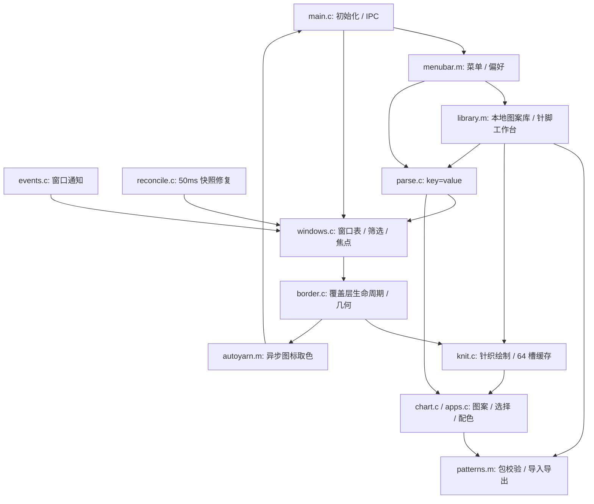

# 架构分析

起点：Window Sweaters `6fc58112ba8f93cabef80b23f2735b3c0533db46`。本文说明当前模块职责和调用链。

- **main.c** 初始化图表、设置、Mach 服务和事件监听。加载菜单偏好后重新应用显式 CLI 参数，再发现现有窗口。菜单/IPC 共用设置处理路径。
- **windows.c / events.c / reconcile.c** 管理目标窗口 ID、所有者与筛选，处理通知并用快照修复遗漏的创建、隐藏、关闭、焦点和空间状态。后台采集、主线程提交。
- **border.c** 外扩目标窗口以容纳边框，创建 SkyLight 透明窗口及 CGContext，更新位置/尺寸、排序、绘制并释放资源。所有图案共用这一条路径。
- **chart.c / apps.c** 加载 56 个内置图案、原有用户颜色网格及用户图案包，管理应用配色与图案选择。九款花草/节日图案是原图案表条目；37 个应用配置保持。
- **knit.c** 将颜色网格编织成周期图块，缓存后绘制到圆角边框环。新图案有固定底色和正向显示标记，沿边居中排列，默认间隔为 0.75 个图案宽，可通过图案库配置；只在局部设置其针脚网格，不更改原毛衣设置。详见[图案设计](theme-system-design.md)。
- **library.m / patterns.m** 分别负责 AppKit 图案库和针脚工作台，以及纯数据图案包的校验、编码、安装与移到废纸篓。草稿和撤销记录保存在编辑器内存中，渲染复用 knit.c；常用线色色板通过 NSUserDefaults 保存；保存时新建或原子替换图案包，再走原重载路径。图案包格式与容量限制见[图案库规范](pattern-library.md)。
- **menubar.m / hidden.m** 管理状态菜单、NSUserDefaults 和应用筛选。Pattern 菜单继续快速选择；Pattern Library 入口打开本地图案库。
- **autoyarn.m** 串行后台取色、主线程更新有界缓存并按 PID 查找目标。新图案的固定底色在渲染时优先，原应用取色流程继续保留。

## 覆盖层与风险

覆盖窗口使用原来的 SkyLight 标签、分辨率、排序和事务；没有增加交互层、动画或外凸挂饰。沿用上游针织边框的 tuck，少量针织延伸到真实窗口下面以遮住移动时的缝隙；内容中央透明。鼠标穿透效果仍需人工验证。

`misc/extern.h`、`misc/window.h`、`misc/connection.h` 使用私有 SLS/SL/CGS API；`misc/ax.h` 使用 `_AXUIElementGetWindow`，main.c 通过 dlsym 查询部分圆角能力。没有进程注入或 SIP 修改。50ms 快照的规模开销、同步私有 API、连续缩放恢复及系统版本变化仍是维护重点；不能由构建成功推断所有桌面行为正常。

图案包校验宽度范围为 2–60 pt；全局 CLI 宽度行为沿用上游。Bundle ID、IPC、配置和产物均与上游隔离，详见[可行性说明](feasibility-assessment.md)。
